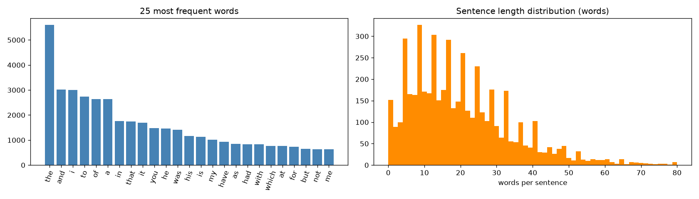
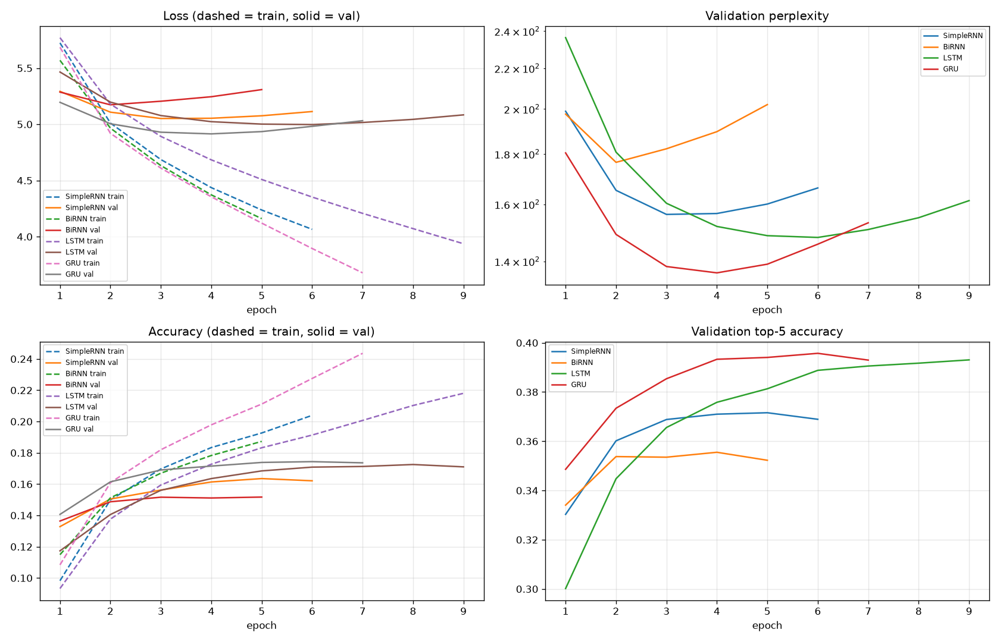
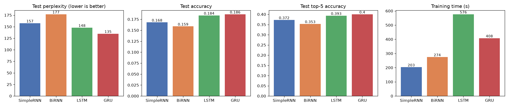
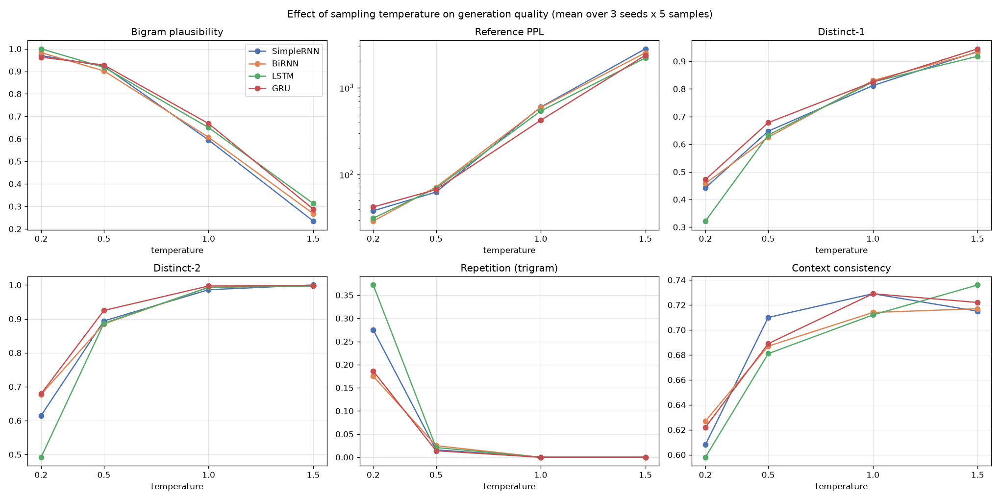

# Comparative Autoregressive Text Generation using Simple RNN, Bidirectional RNN, LSTM and GRU

**Course:** Foundations of Generative AI (ICT4403) — Assignment 2
**Dataset:** *The Adventures of Sherlock Holmes* — Arthur Conan Doyle (Project Gutenberg eBook #1661)

---

## 1. Problem statement and objective
Build an **autoregressive, word-level text-generation system**: it predicts the next word from the previous words and generates text one word at a time from a seed sequence. Four recurrent architectures are implemented and trained under **identical experimental conditions**:

* Simple RNN
* Bidirectional RNN
* LSTM
* GRU

Objectives:
1. Describe and pre-process the dataset, and build input → target sequences for next-word prediction.
2. Compare the models quantitatively (loss, perplexity, accuracy, training time) and qualitatively (coherence, diversity, contextual consistency, repetition).
3. Generate text from the same seeds at several sampling temperatures, analyse the effect of temperature, and identify the best model.

## 2. Dataset
| | |
|---|---|
| Name | *The Adventures of Sherlock Holmes* by Arthur Conan Doyle (1892) |
| Source | https://www.gutenberg.org/ebooks/1661 |
| Plain-text file used | https://www.gutenberg.org/cache/epub/1661/pg1661.txt (copy in `data/sherlock_holmes_1661.txt`) |
| Licence | Public domain (Project Gutenberg) |

**Characteristics** (after removing the Gutenberg licence header/footer, table of contents and chapter headings):

| Characteristic | Value |
|---|---|
| Characters | 561,238 |
| Words | 105,566 |
| Unique words (lower-cased) | 7,956 |
| Words occurring only once | 3,541 (≈ 45 % of the vocabulary) |
| Sentences / paragraphs | 5,121 / 2,527 |
| Avg. words per sentence | 20.6 |
| Stories | 12 short detective stories |

The book is first-person Victorian prose narrated by Dr. Watson. It has long sentences, a lot of dialogue, a recurring cast and a long-tailed (Zipfian) vocabulary. The corpus is small by language-modelling standards, so overfitting is a central issue.



### Pre-processing
1. Strip the Project Gutenberg header/footer, the table of contents and the chapter headings.
2. Lower-case the text and normalise curly quotes and apostrophes. Replace dashes with spaces and remove `_italic_` markers.
3. Tokenise into words (keeping contractions such as `don't`) and the punctuation tokens `. , ! ? ;`. This gives **120,350 tokens**.
4. Build the vocabulary from words with frequency ≥ 2, plus `<pad>` and `<unk>`. This gives **4,418 tokens**. Rare words become `<unk>` (2.9 % of tokens).
5. **Input → target sequences:** a sliding window of 11 tokens (stride 1). The first 10 tokens are the input and the 11th is the target, e.g.
   `bohemia to sherlock holmes she is always the woman .  →  i`
6. The token stream is split **contiguously** into 80 % train / 10 % validation / 10 % test before windowing, so overlapping windows cannot leak between splits. This gives 96,270 / 12,025 / 12,025 sequences.

## 3. Models
Every model uses the same configuration. Only the recurrent layer differs.

`Embedding(4418 → 100) → [recurrent layer, 256 units] → Dropout(0.2) → Dense(4418, softmax)`

| Model | Recurrent layer | Parameters |
|---|---|---|
| Simple RNN | `SimpleRNN(256)`: plain tanh recurrence | 1.67 M |
| Bidirectional RNN | `Bidirectional(SimpleRNN(256))`: reads the 10-word context forwards and backwards | 2.89 M |
| LSTM | `LSTM(256)`: input/forget/output gates + cell state | 1.94 M |
| GRU | `GRU(256)`: update/reset gates | 1.85 M |

Shared training set-up: Adam (lr = 1e-3), sparse categorical cross-entropy, batch size 128, sequence length 10, up to 30 epochs, early stopping on validation loss (patience 3, best weights restored), and a fixed random seed of 42.

**Generation:** at each step the next-word distribution is re-scaled with temperature *T* (`p_T ∝ exp(log p / T)`) and a word is sampled from it (`<pad>`/`<unk>` are never sampled). Settings: 3 seeds, T ∈ {0.2, 0.5, 1.0, 1.5}, 5 samples of 40 words per (model, seed, T), and the same random stream for every model.

## 4. Repository structure
```
├── FGAI_Assignment2_TextGeneration.ipynb   # full implementation (executed, with outputs)
├── README.md
├── requirements.txt
├── data/
│   └── sherlock_holmes_1661.txt            # dataset (downloaded automatically if missing)
├── models/                                 # trained models (.keras)
│   ├── SimpleRNN.keras  BiRNN.keras  LSTM.keras  GRU.keras
└── results/
    ├── dataset_statistics.csv, dataset_overview.png
    ├── model_comparison.csv, model_comparison.png, training_curves.png, training_histories.json
    ├── generated_samples.txt               # all generated text (model x seed x temperature x 5 samples)
    ├── generations_all.csv                 # same, with per-sample metrics
    ├── generation_metrics_by_model_temperature.csv, temperature_analysis.png
    └── overall_summary.csv                 # final ranking
```

## 5. Execution steps and dependencies
Requirements: Python 3.10+, TensorFlow ≥ 2.16, NumPy, pandas, Matplotlib, SciPy, scikit-learn, Jupyter.

```bash
pip install -r requirements.txt
jupyter notebook FGAI_Assignment2_TextGeneration.ipynb
```
Run all cells. The dataset downloads automatically if `data/` is empty. A full run on a CPU takes about 25–30 minutes; on Google Colab, upload the notebook and run all cells. To make a quick test run, set the environment variable `MAX_EPOCHS=1`.

## 6. Results

### Quantitative comparison (test set)
| Model | Best epoch | Test loss | Test perplexity ↓ | Test accuracy ↑ | Top-5 accuracy ↑ | Training time (s) | s / epoch |
|---|---|---|---|---|---|---|---|
| Simple RNN | 3 | 5.059 | 157.5 | 16.8 % | 37.2 % | 203 | 33.8 |
| Bidirectional RNN | 2 | 5.175 | 176.8 | 15.9 % | 35.3 % | 274 | 54.9 |
| LSTM | 6 | 4.996 | 147.9 | 18.4 % | 39.3 % | 576 | 64.0 |
| **GRU** | 4 | **4.904** | **134.8** | **18.6 %** | **40.0 %** | 408 | 58.2 |

(Perplexity = exp(cross-entropy). Training time was measured on CPU and includes the epochs after the best one that early stopping needed.)




### Generation-quality metrics
| Property | Metric |
|---|---|
| Coherence | **Bigram plausibility**: % of generated bigrams that occur in the training text; **Reference PPL**: perplexity of the generated text under an independent smoothed bigram LM |
| Diversity | **Distinct-1 / Distinct-2**: unique uni-/bi-grams ÷ total |
| Repetition | **Repeated-trigram rate**: 1 − unique trigrams ÷ total |
| Contextual consistency | Cosine similarity between the seed and the continuation in a PPMI-SVD word-embedding space built from the training text |

Mean over the moderate temperatures (T = 0.5 and 1.0):

| Model | Bigram plausibility ↑ | Reference PPL ↓ | Distinct-2 ↑ | Repetition ↓ | Context consistency ↑ | **Mean rank** |
|---|---|---|---|---|---|---|
| **GRU** | **0.798** | **244.7** | **0.961** | **0.007** | 0.709 | **1.13** |
| LSTM | 0.784 | 305.0 | 0.940 | 0.011 | 0.696 | 2.44 |
| Simple RNN | 0.759 | 331.0 | 0.940 | 0.008 | 0.719 | 2.56 |
| Bidirectional RNN | 0.754 | 332.0 | 0.939 | 0.012 | 0.700 | 3.88 |

The mean rank combines test PPL, test accuracy, top-5 accuracy and the five generation metrics. Full per-temperature numbers are in `results/generation_metrics_by_model_temperature.csv`.

### Sample generations
Seed: *“i had called upon my friend , and found him”*

| T | Model | Generated continuation |
|---|---|---|
| 0.2 | LSTM | , and I have a little man, and I have a little man. I am not a little man, and I have a little man … |
| 0.2 | Simple RNN | … to the minute of the parish of the parish of the parish of the parish of the parish … |
| 0.5 | LSTM | , mr. Hudson, my stepfather, and I have a card of the police. I have a little man, I remarked. I believe that I have no doubt … |
| 0.5 | GRU | , so we must have seen him to the police, and all I have been able to be a little man. But I could not follow you, said holmes … |
| 1.0 | GRU | . Our instant has unknown upon him, I rushed among home as secretary I answered. It was try, serenely to have, said holmes … |
| 1.5 | SimpleRNN | by my lodge lens such through foul gaiters any dusk engaged upon till time into whistles use after until father's best … |

All 240 samples are in [`results/generated_samples.txt`](results/generated_samples.txt).

## 7. Model comparison and evaluation
* **GRU** is best on every main metric: lowest test perplexity (134.8), highest top-1 and top-5 accuracy, and best generation scores. It reaches its best validation loss at epoch 4.
* **LSTM** is a close second (PPL 147.9). It learns more slowly (best epoch 6) and is the most expensive model to train (576 s). At low temperature it is the most prone to repetitive loops (37 % repeated trigrams at T = 0.2).
* **Simple RNN** is the fastest per epoch (34 s), but its plain recurrence suffers from vanishing gradients. It peaks at epoch 3 with a clearly higher perplexity (157.5), and it produces the classic *“of the parish of the parish …”* loops.
* **Bidirectional RNN** has the most parameters (2.89 M), but it overfits fastest (best epoch 2) and gets the *worst* perplexity (176.8). Reading the 10-word context backwards adds capacity but no useful signal for predicting the *next* word. During generation only the left context exists, so bidirectionality does not suit autoregressive modelling.
* **Overfitting:** with only about 120 k tokens, every model's training loss keeps falling while validation loss rises after 2–6 epochs (see the training curves). Early stopping with best-weight restoration is therefore essential. The gated models (GRU and LSTM) generalise best.
* Absolute accuracy (about 19 %) and perplexity (about 135) are typical for word-level models trained on a single small book. Top-5 accuracy of 40 % shows the models usually rank the correct word highly.

## 8. Sampling-temperature analysis


| T | Coherence | Diversity | Repetition | Observation |
|---|---|---|---|---|
| 0.2 | Very high (96–100 % plausible bigrams, ref. PPL 30–40) | Low (distinct-2 0.49–0.68) | **High** (18–37 % repeated trigrams) | Near-greedy: safe, frequent phrases that fall into loops (“a little man, and a little man …”) |
| 0.5 | High (90–93 %) | Good (distinct-2 0.89–0.93) | Very low (1–2.5 %) | **Best balance**: fluent Holmes-style narration with variety |
| 1.0 | Medium (60–67 %, ref. PPL about 10× higher) | Very high (≈ 0.99) | None | Rich, rare vocabulary, but grammar breaks down |
| 1.5 | Low (25–30 %, ref. PPL > 2000) | Maximal | None | Close to a random bag of words |

Raising the temperature flattens the next-word distribution. This **increases diversity and removes repetition, but reduces coherence**, and the useful range here is **T ≈ 0.5–0.7**. The context-consistency proxy rises only mildly with temperature: once the text is fragmented, the score mostly reflects general topical vocabulary, so it was weighted together with the other measures and not on its own. At every temperature GRU stays the most coherent or nearly so: it has the lowest reference PPL at T = 1.0 and the highest bigram plausibility at T = 0.5–1.0. At low T it also loops less than LSTM and Simple RNN.

## 9. Conclusion
**The GRU model gives the most effective autoregressive text generation for the Sherlock Holmes dataset.** It achieves:
* the lowest test perplexity (134.8) and the highest test accuracy (18.6 % top-1, 40.0 % top-5);
* the best combined generation quality at practical temperatures: most coherent, most diverse and least repetitive;
* about 30 % less training time than the LSTM, with fewer parameters.

LSTM is a strong second. Simple RNN is limited by vanishing gradients. The Bidirectional RNN is the least suitable, because its backward pass cannot be used during left-to-right generation and it overfits fastest. The recommended configuration is **GRU sampled at T ≈ 0.5–0.7**.
